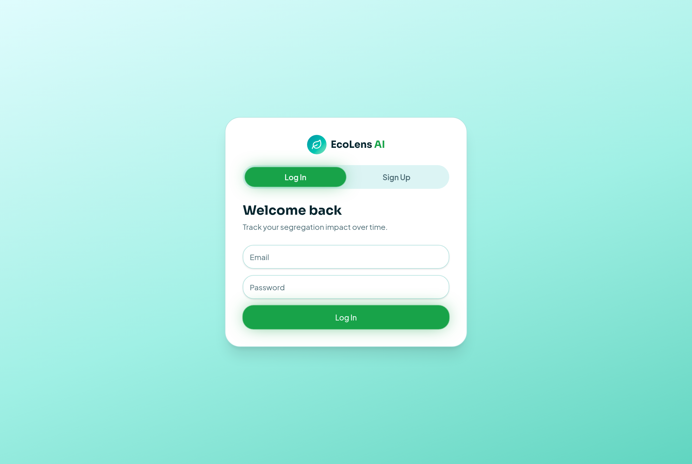
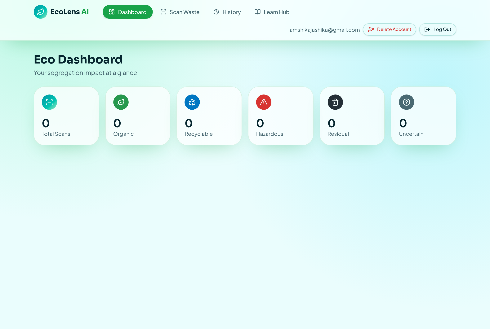
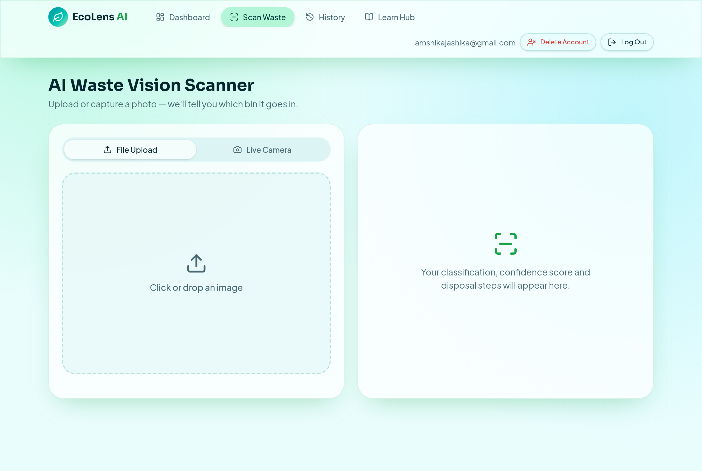
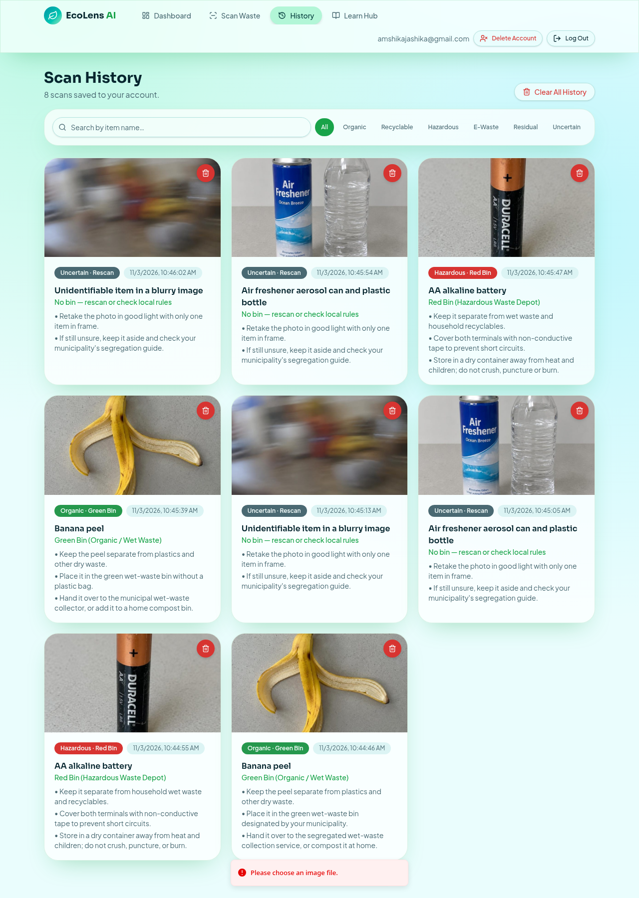
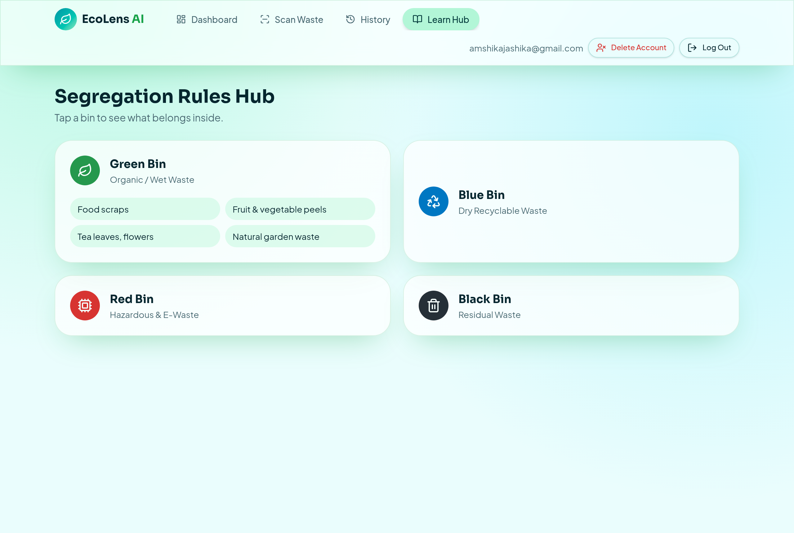
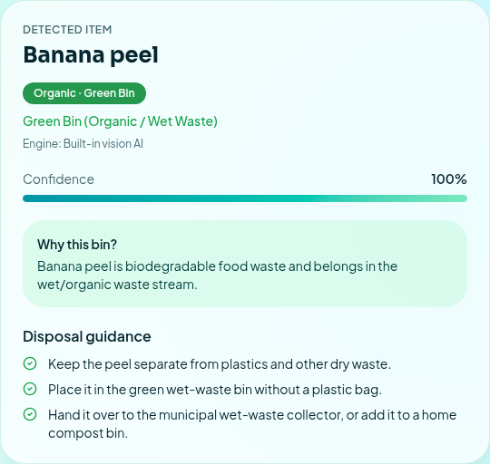
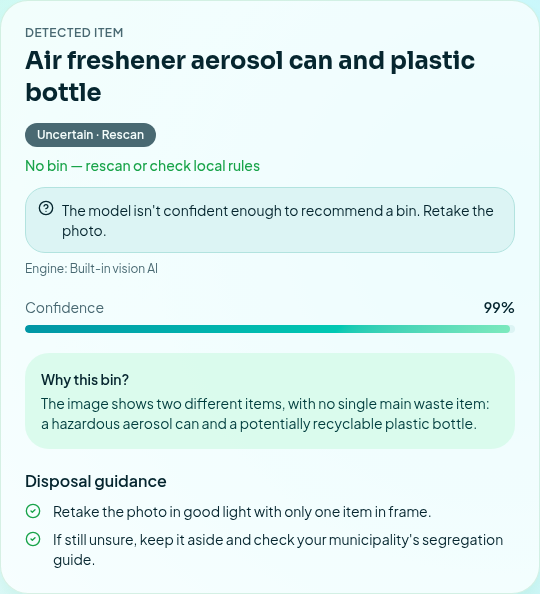

# EcoLens AI — Smart Waste Segregation System

**Scan. Sort. Save.**

**Neural Storm 2026 · Track: Green Planet · Problem Statement GP-05: Smart Waste Segregation System**

| | |
|---|---|
| Team name | solo stack |
| Team leader | Jashika Rajasekaran |
| Institution | Rathinam Technical Campus |

Live app: <https://eco-len.lovable.app>



## Problem

Mixed household waste ruins recycling streams and sends hazardous items (batteries, aerosols, e-waste) to landfill. Most people don't know which bin an item belongs in, and segregation guides are easy to forget.

## Solution

EcoLens AI lets anyone photograph a waste item (upload or live camera). A vision AI model identifies the item, assigns it to one of five categories, recommends the correct bin, and gives disposal steps. When the model is not confident, the app reports **Uncertain** and asks for a rescan instead of guessing. Every scan is stored in the user's private history and feeds a personal dashboard.

| Category | Bin |
|---|---|
| Organic | Green Bin (wet waste) |
| Recyclable | Blue Bin (dry recyclable) |
| Hazardous / E-waste | Red Bin (hazardous / e-waste depot) |
| Residual | Black Bin (non-recyclable) |
| Uncertain | No bin — rescan (confidence < 55 %, blurry image, or several mixed items) |

## Screenshots

| | |
|---|---|
|  |  |
|  |  |
|  |  |

## Features

- Email/password accounts (Lovable Cloud auth, hashed passwords, email confirmation)
- Image upload + live camera capture, client-side resize, server-side type/size/magic-byte validation
- Real vision-model classification with confidence, explanation, bin and disposal steps
- Uncertain-result handling; explicit error state — no result is shown or saved if the AI fails
- History stored per user in a database with row-level security; single-scan delete (with confirmation), clear all, delete account, search and filter by category
- Dashboard computed from the user's stored scans: category counts, category split, average confidence, recent scans
- Learn hub with consistent cards for all five waste categories plus the Uncertain rule
- Optional FastAPI classification service (see *Python backend* below)

## Technology stack

- **Frontend:** React 19, TanStack Start (SSR + server functions), Tailwind CSS v4, shadcn/ui, lucide-react icons
- **Backend:** Lovable Cloud (hosted Postgres with row-level security, email/password auth, server functions)
- **AI:** vision models through the Lovable AI Gateway (`openai/gpt-6-astra`) via the AI SDK
- **Optional service:** Python 3.13, FastAPI, uvicorn, httpx
- **Testing:** Vitest (unit), Playwright (end-to-end)

## Architecture

```text
Browser (React, TanStack Start)
   │  upload / camera image (data URL)
   ▼
classifyWaste server function  (auth required, validates image)
   ├─ if PYTHON_CLASSIFIER_URL set ─► Python FastAPI /classify ─► vision model API
   └─ else ─────────────────────────► Lovable AI Gateway (openai/gpt-6-astra vision)
   │  normalizePrediction(): server-owned bin mapping + uncertainty threshold
   ▼
Lovable Cloud Postgres `scans` table (RLS: user can only see own rows)
```

**Production AI architecture as deployed today:** classification runs in the authenticated `classifyWaste` server function and calls the Lovable AI Gateway with the managed app key (`LOVABLE_API_KEY`). No third-party AI key is stored in the codebase. The Python service is **not deployed**; enabling it only requires hosting `backend/` and setting the `PYTHON_CLASSIFIER_URL` secret. There is **no silent fallback**: if the Python service is configured and unreachable, the scan fails visibly.

### Frontend (`src/`)
- `src/routes/index.tsx` — UI (auth, scanner, dashboard, history, learn)
- `src/lib/classify.functions.ts` — authenticated server functions (classify + save, delete account)
- `src/lib/scan-schema.ts` — image validation, prediction normalization, bin mapping
- `src/lib/eco-store.ts` — row mapping and dashboard statistics

### Python backend (`backend/`)
- `backend/main.py` — FastAPI service, `POST /classify`, `GET /health`
- `backend/requirements.txt`

It sends the uploaded image to a real vision model over an OpenAI-compatible Chat Completions API (Lovable AI Gateway by default), validates the JSON reply, applies the same 55 % uncertainty rule, and returns an HTTP error (never a fake prediction) on any failure.

## Run locally

### Web app
```bash
bun install
bun run dev
```

### Python service
```bash
cd backend
python3 -m venv .venv && source .venv/bin/activate
pip install -r requirements.txt
export AI_API_KEY=...            # Lovable AI Gateway key or any OpenAI-compatible key
uvicorn main:app --port 8000
```

Deploy it to any Python host (Render, Railway, Fly.io…) with start command `uvicorn main:app --host 0.0.0.0 --port $PORT` and `AI_API_KEY` set. The URL must be publicly reachable over HTTPS. Then set the app secret `PYTHON_CLASSIFIER_URL=https://your-service` to route classifications through it. Without that secret the app uses the built-in AI path.

## Environment variables

| Name | Where | Purpose |
|---|---|---|
| `LOVABLE_API_KEY` | app server (managed by Lovable) | Built-in AI classification |
| `PYTHON_CLASSIFIER_URL` | app server (optional) | Use the FastAPI service instead |
| `AI_API_KEY` | Python service | Vision API key |
| `AI_BASE_URL` | Python service (optional) | Default `https://ai.gateway.lovable.dev/v1` |
| `AI_MODEL` | Python service (optional) | Default `google/gemini-3-flash-preview` |
| `CORS_ORIGINS` | Python service (optional) | Comma-separated origins, default `*` |

No keys are hardcoded in the repository.

## API

`GET /health` → `{"status":"ok","model":"...","configured":true}`

`POST /classify` (multipart, field `file`, JPEG/PNG/WebP ≤ 6 MB) →
```json
{"item":"plastic water bottle","category":"recyclable","confidence":100,
 "reasoning":"...","steps":["..."],"bin":"Blue Bin (Dry Recyclable Waste)"}
```
Both engines return the same fields (`item, category, confidence, reasoning, steps`; the Python service also returns `bin`). The app re-derives `bin` and the uncertain rule itself in `normalizePrediction`, so both paths are stored identically.

Errors: `413` too large, `415` not an image, `422` missing file field, `503` no key, `502` model error/malformed output, `402/429` usage limits.

## Testing

### Unit tests (`bunx vitest run`)
- Bin mapping for all five categories, uncertainty threshold (54 → uncertain, 55 → kept)
- Rejection of malformed model output and non-image uploads, oversized-image rejection
- Dashboard statistics (category counts, e-waste grouped under hazardous, average over confident scans only)

### End-to-end (built-in AI path, run 3 Nov 2026, real UI in a headless browser)

Test photos were AI-generated. Confidence is the model's self-reported estimate — **not classification accuracy**. No accuracy, precision, recall, F1 or latency numbers are claimed because none were measured.

| Case | Result |
|---|---|
| Banana peel | organic, 100 % |
| Single AA battery | hazardous, 100 % |
| Two items (aerosol can + plastic bottle) | uncertain — model reported two items, no single main item |
| Blurry photo | uncertain |
| Non-image upload (text file) | rejected in the browser with "Please choose an image file." |
| Reload after scans | history and dashboard rebuilt from the database |

### Python service checks (3 Nov 2026, local uvicorn run)
- `GET /health` → ok; `POST /classify` with a text file → `415`; oversized image → `413`; missing file field → `422`; valid image without `AI_API_KEY` → `503` with a visible message.

**NOT TESTED (honest gaps):**
- A successful end-to-end classification *through the Python service* (needs an `AI_API_KEY` on a running service — not exercised in the runs above).
- A *deployed* Python service connected via `PYTHON_CLASSIFIER_URL` (no deployment exists).
- Clicking a real email-confirmation link; a real physical camera.

### Mixed-item behaviour
The classification prompt instructs the model to answer `uncertain` when several mixed items appear with no single main item, and in the 3 Nov 2026 runs both a mixed-item photo and a blurry photo were reported as **uncertain**. This rule is enforced in the app's own confidence threshold (< 55 %), but whether the model flags a mixed photo as such depends on the model — it is asked for, not guaranteed.

## Limitations
- Accuracy depends on the third-party vision model; confidence is the model's self-reported estimate, not calibrated accuracy.
- One main item per photo is expected; mixed photos should return Uncertain (see above).
- Bin colours follow common Indian municipal rules; local rules vary.
- Images are stored as compressed data in the database (≤ 768 px).

## Deployment

The web app is published on Lovable at <https://eco-len.lovable.app> (frontend, auth, database and the classification server function all run there — no separate hosting is required). The optional Python service has its own deployment instructions in *Run locally → Python service* above.

## Demo
1. Sign up and confirm your email, then log in.
2. Scan Waste → upload or use the camera → Analyze Waste.
3. Open Dashboard and History to see stored results; try a blurry photo to see the Uncertain state.

## AI tools disclosure
- Built with the Lovable AI coding assistant.
- Classification uses third-party vision models through the Lovable AI Gateway. No custom model was trained.
- Test images used in the evaluation tables were AI-generated.
